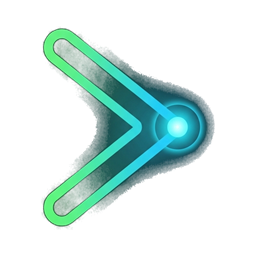

<div align="center">
  
  <h1>Axon ⚡</h1>
  <p><em>Emulador de terminal nativo, ultra-rápido y minimalista para Windows, diseñado para desarrolladores y agentes de IA en la CLI</em></p>
</div>

**Axon** es un emulador de terminal nativo, ultra-rápido y minimalista para Windows, escrito en Rust y diseñado específicamente para desarrolladores y **agentes de IA en la línea de comandos** (*Claude Code, Aider, Herdr, Copilot CLI, etc.*).

Inspirado en la estética y rendimiento de [Ghostty](https://ghostty.org), Axon prescinde de capas pesadas como Electron o WebViews para ofrecer una experiencia ligera con renderizado directo acelerado por CPU/GPU, integración profunda con Windows 11 y soporte completo para el estándar VT/ECMA-48 y Windows ConPTY.

---

## ✨ Características Principales

* **🚀 Rendimiento Nativo Puro:** Construido en Rust sobre `winit` y `softbuffer`. Cero dependencias web, arranque instantáneo y latencia de pulsación mínima.
* **🎨 Estética Ghostty:** Paleta oscura Ghostty, espaciado uniforme, renderizado de texto nítido y barra de título inmersiva con soporte nativo para **Mica** y **Dark Mode (DWM)** de Windows 11.
* **🔤 JetBrains Mono Nerd Font Integrada:** Incluye iconos de desarrollo, símbolos Powerline, glifos Git y caracteres de diagramación (Box Drawing/Braille) sin necesidad de configurar fuentes en el sistema.
* **🤖 Diseñado para Agentes de IA:**
  * **Pegado Inteligente de Imágenes:** Al pulsar `Ctrl+V` con una captura en el portapapeles (Snipping Tool, recorte de pantalla), Axon guarda el PNG en caché temporal y pega la ruta entrecomillada para consumo directo por herramientas de IA.
  * **Soporte `Alt+V`:** Compatibilidad con pegado de chips de imagen nativos en Claude Code.
  * **Navegación Semántica (OSC 133):** Salta entre comandos y prompts de agentes con `Ctrl+Shift+Arriba` / `Ctrl+Shift+Abajo`.
  * **Copiar Salida del Último Comando:** Extrae la salida generada por el agente directamente al portapapeles con `Ctrl+Shift+O`.
* **🖥️ Motor VT / ECMA-48 Completo:**
  * Soporte para secuencias `ED` (modo 2 y modo 3 para purga total de scrollback al hacer `clear`).
  * Secuencias de edición en línea: **ECH** (`\x1b[PnX]`), **DCH** (`\x1b[PnP]`), **ICH** (`\x1b[Pn@]`) y **EL** (`\x1b[PnK]`).
  * **TrueColor (24-bit RGB):** Formatos tanto con punto y coma (`38;2;R;G;B`) como con dos puntos (`38:2:R;G;B`).
  * **Bracketed Paste Mode:** Evita la ejecución accidental de comandos multilínea pegados.
  * **Anti-Flicker:** Soporte para renderizado sincronizado DEC 2026.
  * **TUI Mouse Tracking:** Compatible con herramientas interactivas (Ratatui, Lazygit, Herdr, btop) usando SGR 1006 / 1002.
* **📑 Pestañas Verticales y Múltiples Sesiones (Sidebar):**
  * Barra lateral izquierda nativa para abrir y alternar entre múltiples instancias de terminal simultáneas.
  * Botón interactivo `+` para spawnear nuevas sesiones independientes con su propio proceso ConPTY.
  * Botón `×` en pestañas inactivas/activas para cerrar sesiones.
  * Indicador de foco activo con acento verde Ghostty (`#51e27a`) y punto azul de actividad (`#4e92f9`) cuando una terminal en segundo plano recibe nueva salida de un comando.
  * Botón interactivo inferior `[ < Ocultar ]` en el sidebar y botón flotante `[ > ]` cuando está colapsado para alternar con un clic la visibilidad del panel.
  * Barra lateral colapsable dinámicamente también con `Ctrl + B`.
* **⌨️ Teclado Preciso en Windows:**
  * Borrado de 1 carácter con `Backspace` (`0x7f`) y borrado de palabra con `Ctrl+Backspace` (`0x17`) / `Alt+Backspace` (`\x1b\x7f`).
  * Aislamiento de hardware para `AltGr` (`VK_RMENU`), impidiendo que el Control sintético de Windows quede atascado.
  * Protección total contra `Alt+Tab`, evitando que se dispare el tabulador al alternar ventanas.

---

## ⌨️ Atajos de Teclado

| Atajo | Acción |
| :--- | :--- |
| `Ctrl + T` / `Ctrl + Shift + T` | **Nueva pestaña / terminal** |
| `Ctrl + W` / `Ctrl + Shift + W` | **Cerrar pestaña activa** |
| `Ctrl + Tab` / `Ctrl + Shift + Tab` | **Pestaña siguiente / anterior** |
| `Ctrl + 1` .. `Ctrl + 9` | **Cambiar directamente a pestaña 1-9** |
| `Ctrl + B` | **Alternar visibilidad de la barra lateral** |
| `Ctrl + Shift + C` / `Ctrl + C` | Copiar texto seleccionado |
| `Ctrl + Shift + V` / `Ctrl + V` | Pegar texto o imagen desde el portapapeles |
| `Alt + V` | Enviar secuencia Alt+V para imágenes en Claude Code |
| `Backspace` | Borrar un único carácter hacia atrás |
| `Ctrl + Backspace` / `Alt + Backspace` | Borrar la palabra completa anterior |
| `Ctrl + Delete` | Borrar la palabra siguiente |
| `Ctrl + Flecha Izq / Der` | Saltar palabra hacia atrás / adelante |
| `Ctrl + Shift + K` / `Ctrl + Shift + L` | Limpiar pantalla y vaciar scrollback (*Ghostty style*) |
| `Ctrl + Shift + O` | Copiar salida del último comando ejecutado |
| `Ctrl + Shift + Arriba / Abajo` | Navegación semántica entre prompts OSC 133 |
| `Ctrl + +` / `Ctrl + -` | Aumentar / Disminuir tamaño de fuente |
| `Ctrl + 0` | Restablecer tamaño de fuente por defecto |
| `Ctrl + Shift + ,` | Recargar configuración en caliente |
| `Shift + PageUp / PageDown` | Desplazamiento por el historial de terminal |

---

## 🛠️ Instalación y Compilación

### Requisitos
* Windows 10 o Windows 11 (x64)
* [Rust y Cargo](https://rustup.rs/) (versión 1.75 o superior)

### Clonar y Compilar

```powershell
# Clonar el repositorio
git clone https://github.com/GonzhaI/axon.git
cd axon

# Compilar versión optimizada en Release
cargo build --release

# Ejecutar Axon
.\target\release\axon.exe
```

---

## ⚙️ Configuración (`axon.toml`)

Axon busca su archivo de configuración en el mismo directorio del ejecutable o en `%APPDATA%\axon\axon.toml`. Si no existe, se genera automáticamente con los siguientes valores por defecto:

```toml
[appearance]
font_family = "JetBrains Mono Nerd Font"
font_size = 14.0
line_height = 1.2
padding_x = 12
padding_y = 10
theme = "ghostty-dark"

[terminal]
default_shell = "powershell.exe"
scrollback_lines = 10000
cursor_blink = true
ghostty_prompt = true
```

---

## 🧪 Pruebas Automatizadas

Axon incluye una suite completa de pruebas unitarias y de integración con ConPTY:

```powershell
cargo test
```

---

## 📄 Licencia

Distribuido bajo la licencia MIT. Consulta el archivo `LICENSE` para más información.
